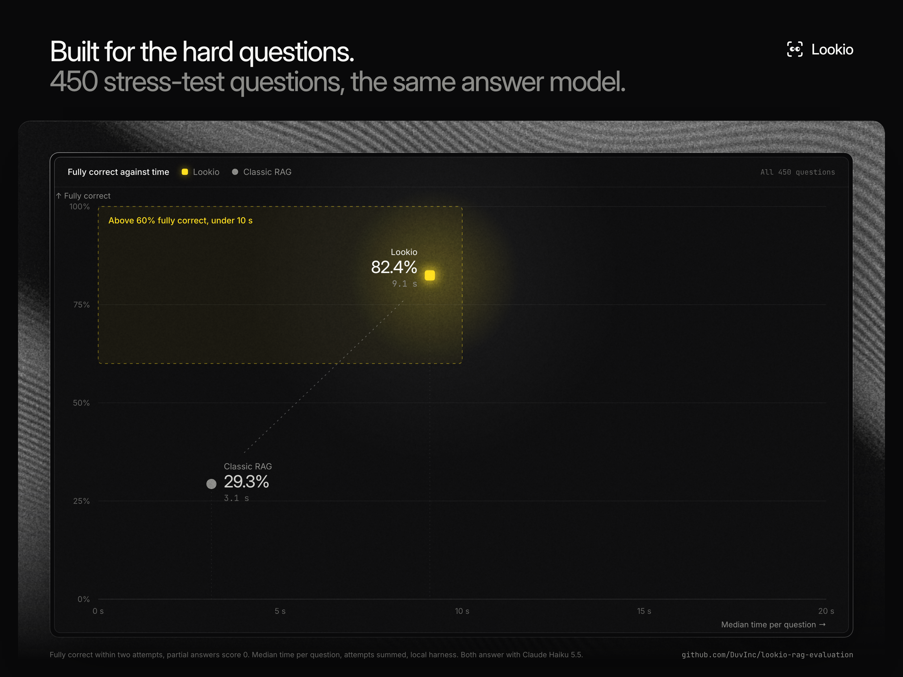

# Lookio RAG evaluation

**[Lookio](https://lookio.app) answers 82.4% of 450 hard questions fully correctly. A plain RAG pipeline answers 29.3%.** Every question, answer and timing is here, so you can check it yourself.

Same documents, same model (Claude Haiku 5.5), 450 questions, at most two attempts each, partial answers worth nothing. Lookio: **371/450 (82.4%)**, median 9.1 s. Classic RAG: **132/450 (29.3%)**, median 3.1 s. These are reference-selected two-attempt results, not single-attempt accuracy.

[Try Lookio](https://lookio.app) · [Read the benchmark write-up](https://lookio.app/blog/rag-benchmark-results)


```sh
git clone git@github.com:DuvInc/lookio-rag-evaluation.git
cd lookio-rag-evaluation
npm test
npm run report
```

Both commands run locally with Node 22+, without dependencies, credentials or model calls. They verify the release and recompute the scores from the published individual attempts.

## Results

| Dataset | Questions | Classic RAG | Lookio |
| :--- | ---: | ---: | ---: |
| [Arvenne RAG Bench](https://github.com/DuvInc/arvenne-rag-bench) | 150 | 67/150 (44.7%) | 132/150 (88.0%) |
| [DataBench](https://huggingface.co/datasets/cardiffnlp/databench) | 150 | 37/150 (24.7%) | 133/150 (88.7%) |
| [HybridQA](https://github.com/wenhuchen/HybridQA) | 150 | 28/150 (18.7%) | 106/150 (70.7%) |
| **All questions** | **450** | **132/450 (29.3%)** | **371/450 (82.4%)** |

The three datasets are stress tests, harder than most questions people ask a knowledge base: calculations over whole tables (DataBench), answers that need a table row and its linked text (HybridQA), and company files with scans, spreadsheets and conflicting rules (Arvenne).



The same results [per dataset](docs/figures/small-multiples.png) and [as a summary](docs/figures/editorial.png). `npm run figures` rebuilds the three images from `data/answers.jsonl` (needs a local Chrome).

The 450-question set gives equal weight to the three datasets. These are evaluated subsets of DataBench and HybridQA, not their complete official benchmark runs. Arvenne is a synthetic dataset from Lookio's developer; it is linked as a separate project rather than embedded here. See [methodology](METHODOLOGY.md) for the boundaries of the comparison.

## Every question and answer is available

| File | Contents |
| :--- | :--- |
| [data/questions.jsonl](data/questions.jsonl) | All 450 exact questions, expected answers, source IDs and available rubrics/tolerances |
| [data/answers.jsonl](data/answers.jsonl) | 900 selected full answers, their verdicts, attempt counts and timings |
| [data/attempts.jsonl](data/attempts.jsonl) | All 1,323 actual candidate answers, including unsuccessful and partial candidates |
| [data/sources.json](data/sources.json) | Dataset links, versions, provenance and license notes |
| [results.json](results.json) | Aggregate strict results, independently recomputable |
| [baseline/config.json](baseline/config.json) | Baseline settings and exact reader prompts |
| [baseline/README.md](baseline/README.md) | Text extraction, chunking, retrieval and generation details |
| [grading/](grading/) | Exact reference-based judge prompt and model settings |

Join the files on `id`; answers and attempts also carry `system`. `classic-rag` and `lookio-v2` are the only systems in this release. Answer text is complete, not truncated. Original benchmark citation markers in an answer are preserved as text; this release does not include Lookio's internal evidence traces.

## What the two systems mean

The baseline is a deliberately simple **text-only, dense top-10 RAG**: plain text extraction, recursive 500-character chunks with 50-character overlap, the source title prefixed to each chunk, `text-embedding-3-small` embeddings, cosine retrieval and one answer-generation call. It has no OCR, reranker, query rewrite or table-execution step. It is one defined baseline, not the best achievable open-source RAG system.

Lookio is a **proprietary document question-answering system**, evaluated in its Deep configuration using a local evaluation harness. Both systems' text-generation calls use **Claude Haiku 5.5**, `anthropic/claude-haiku-5.5`, with reasoning disabled. The systems differ in document processing, available capabilities and number of internal calls. The result compares complete systems rather than one retrieval algorithm in isolation.

## Two attempts and timing, briefly

Each system may answer a question up to twice. A new attempt is run only when the existing answer is not fully correct, without supplying the previous answer, grade or reference to the system. The evaluator selects success against the reference. Identical candidate text retains its existing grade. The published headline counts only fully correct questions, with all 450 questions retained in each system's denominator.

Each candidate has its own `latency_ms`. A selected answer has `selected_attempt_latency_ms` and `total_attempt_latency_ms`, the sum of the attempts actually executed for that system/question. These are local-harness answer wall times, excluding indexing and judging, and are not production API latency or a service-level guarantee. We do not claim that an application can select the right candidate or reproduce this oracle score without the reference answer.

## Scope, attribution and corrections

This is an exploratory, vendor-authored evaluation, not an independent ranking or a preregistered study. The dataset selection and evaluation configuration were informed by earlier exploratory work. One automated judge, from the same model family as the answer model, grades candidates without the system identity. Automated grading can be wrong. The evaluated corpora are bounded, not web-scale. The same underlying documents are provided to both systems, but their supported ways of reading those documents differ.

This release compares answer quality. It does not evaluate production uptime, access-control correctness, all product modes or every RAG configuration. See [METHODOLOGY.md](METHODOLOGY.md), [DATA_LICENSES.md](DATA_LICENSES.md) and [CONTRIBUTING.md](CONTRIBUTING.md). Corrections should identify the question ID and explain the evidence; original release files remain auditable.
